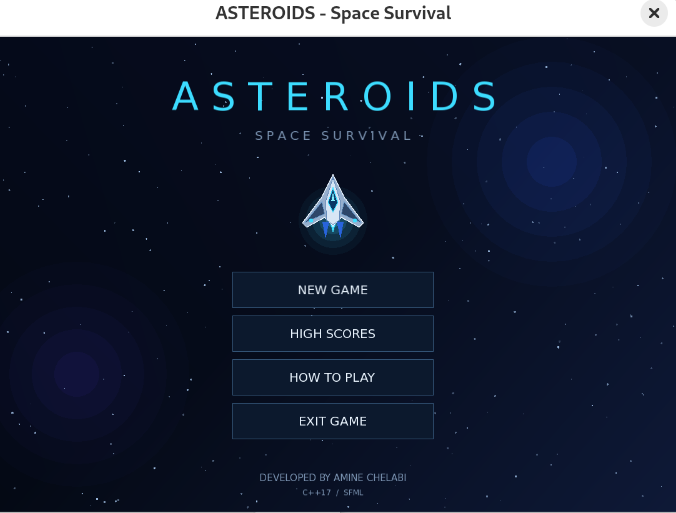
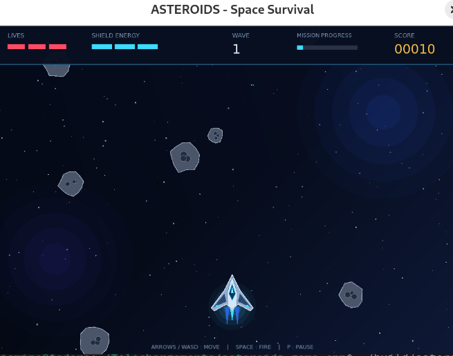

# Asteroids — Space Survival Game

A graphical 2D arcade game developed in modern C++17
using SFML 2.6.

## Overview

Originally developed as an academic C++ project in 2023,
the game was subsequently redesigned with a graphical
interface, improved game mechanics and modern C++
programming practices.

The player controls a spaceship, avoids incoming
asteroids and destroys them using laser cannons.

## Features

- Interactive graphical main menu
- Custom spaceship design with animated thrusters
- Animated starfield background
- Randomly generated rotating asteroids
- Dual laser cannons
- Collision detection
- Particle-based explosion effects
- Lives and shield energy management
- Progressive difficulty
- Pause and resume functionality
- Persistent high-score system

## Screenshots

### Main Menu



### Gameplay



## Technologies

- C++17
- SFML 2.6
- CMake
- Object-oriented programming
- Standard Template Library (STL)
- Linux / Fedora
- Git

## Project Structure

```text
asteroids-game-cpp/
├── src/
│   └── main.cpp
├── assets/
│   └── font.ttf
├── docs/
│   ├── menu.png
│   └── gameplay.png
├── CMakeLists.txt
├── .gitignore
└── README.md
```

## Installation

### Requirements

- C++17-compatible compiler
- CMake 3.16 or later
- SFML 2.6

### Fedora

```bash
sudo dnf install gcc-c++ cmake SFML-devel
```

### Build

```bash
cmake -S . -B build
cmake --build build -j4
```

### Run

```bash
./build/asteroids
```

## Controls

| Key | Action |
|-----|--------|
| Arrow keys / WASD | Move spaceship |
| Space / B | Fire lasers |
| P | Pause / Resume |
| Q | Return to menu |
| Enter | Confirm |
| Mouse | Menu navigation |

## Technical Highlights

- Object-oriented game architecture
- Frame-rate-independent movement using delta time
- Procedural spaceship and asteroid rendering
- Real-time collision detection
- Particle animation system
- Automatic memory management using STL containers
- File-based score persistence
- CMake build configuration

## Author

**Amine CHELABI**

Computer Vision, Artificial Intelligence and
Scientific Software Development.

Academic project originally developed in 2023
and modernized in 2026 with AI-assisted development.

