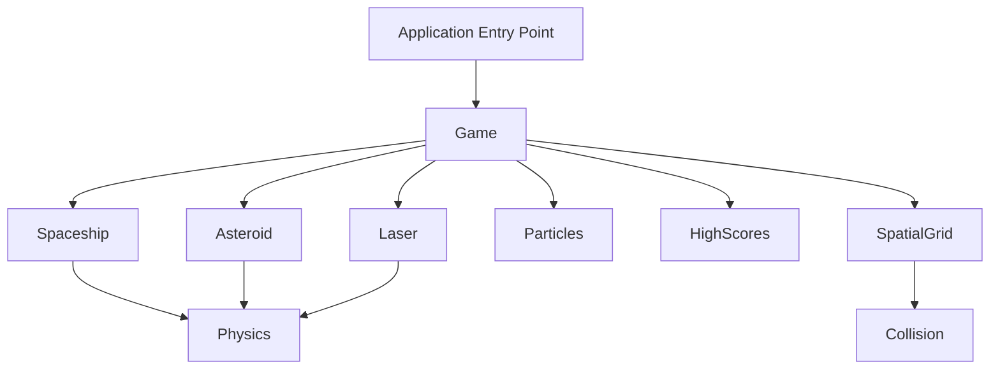

# Asteroids — C++ Software Engineering


## Overview

Asteroids is an academic C++ project originally developed
during my Bachelor's degree at the Université de Haute-Alsace.

The project implements a 2D interactive simulation with
modular software architecture, geometric collision detection,
spatial partitioning and automated testing.

## Technical Features

- Modern C++17 and object-oriented programming.
- Modular software architecture.
- Real-time 2D rendering with SFML.
- Physics calculations independent of graphical rendering.
- Finite state machine for game state management.
- Spatial hash grid for efficient collision detection.
- Hybrid collision detection strategy.
- Persistent high-score management.
- Automated unit tests with CTest.
- Continuous integration with GitHub Actions.
- Reproducible performance benchmarks.

## Performance Optimization

Collision detection was evaluated by comparing an exhaustive
search algorithm with a spatial hash grid.

### Benchmark Configuration

- 5,000 asteroids
- 5,000 projectiles
- 11 repetitions
- Median execution time
- Fedora Linux
- GCC 14.2.1

### Results

| Metric | Exhaustive | Spatial Grid |
|---|---:|---:|
| Runtime | 79.490 ms | 1.324 ms |
| Comparisons | 21,131,033 | 3,778 |
| Detected matches | 775 | 775 |

**Measured speedup: 60.04x**

**Reduction in execution time: 98.33%**

**Reduction in comparisons: 99.982%**

Both algorithms produced identical collision results
in the evaluated scenario.

These measurements concern a synthetic collision benchmark,
not the overall game frame rate.

## Software Architecture



See [Architecture Documentation](docs/architecture.md)
for additional technical details.

## Technologies

| Category | Technologies |
|---|---|
| Programming | C++17, STL, OOP |
| Graphics | SFML |
| Algorithms | Spatial hashing, geometric collisions |
| Build system | CMake |
| Testing | CTest |
| Benchmarking | std::chrono |
| Version control | Git, GitHub |
| CI/CD | GitHub Actions |
| Environment | Linux, Fedora, GCC |

## Installation

### Fedora

```bash
sudo dnf install gcc-c++ cmake SFML-devel
```

### Build

```bash
git clone https://github.com/amine-chelabi/asteroids-game-cpp.git
cd asteroids-game-cpp

cmake -S . -B build -DCMAKE_BUILD_TYPE=Release
cmake --build build --parallel
```

### Run

```bash
cd build
./asteroids
```

## Automated Tests

```bash
ctest --test-dir build --output-on-failure
```

## Performance Benchmarks

```bash
cmake -S . -B build-bench \
    -DCMAKE_BUILD_TYPE=Release \
    -DBUILD_GAME=OFF \
    -DBUILD_BENCHMARKS=ON

cmake --build build-bench --parallel

./build-bench/benchmark_collision
./build-bench/benchmark_spatial
```

## Game Controls

| Key | Action |
|---|---|
| Arrow keys / WASD | Move |
| Space | Fire |
| P | Pause |
| Q | Return to main menu |

## Memory Safety and Software Validation

Memory analysis and runtime validation were performed
on Fedora Linux using Valgrind, AddressSanitizer (ASan)
and UndefinedBehaviorSanitizer (UBSan).

### Valgrind Results

| Metric | Result |
|---|---:|
| Memory allocations | 28,183 |
| Memory deallocations | 28,183 |
| Memory leaks | 0 bytes |
| Detected errors | 0 |

### Sanitizer Results

| Test suite | Status |
|---|---|
| Collision detection | Passed |
| Physics calculations | Passed |
| Spatial partitioning | Passed |

All three test suites passed with ASan and UBSan enabled.

Valgrind validation was performed on the spatial grid
test suite. Results do not cover the full graphical application.

## Author

**Amine CHELABI**

Computer Vision, Artificial Intelligence
and Scientific Software Development.

Academic project — Université de Haute-Alsace.
