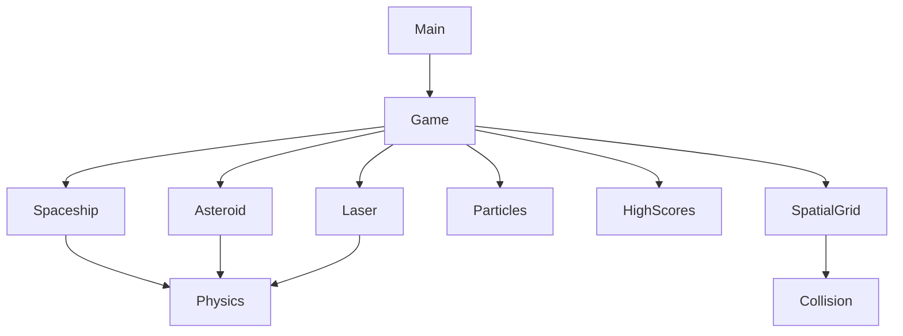

# Software Architecture

## Overview

Asteroids is a 2D game developed in C++17
using SFML for graphical rendering.

## Core Components

- Game: application lifecycle and game state management.
- Physics: motion and physical calculations.
- Collision: geometric collision detection.
- SpatialGrid: spatial partitioning using hash tables.
- Spaceship: player movement and state.
- Asteroid: obstacle generation and motion.
- Laser: projectile management.
- Particles: visual effects.
- HighScores: persistent score management.

## Architecture Diagram

## Performance Evaluation

The spatial hash grid was evaluated using
5,000 asteroids and 5,000 projectiles.

| Metric | Exhaustive | Spatial Grid |
|---|---:|---:|
| Median runtime | 79.490 ms | 1.324 ms |
| Comparisons | 21131033 | 3778 |
| Detected matches | 775 | 775 |

Measured speedup: 60.04x.

Results obtained on Fedora using 11 repetitions
on a synthetic collision benchmark.

## Software Quality

- Modular C++17 architecture
- Automated unit tests with CTest
- Reproducible performance benchmarks
- Continuous integration with GitHub Actions
